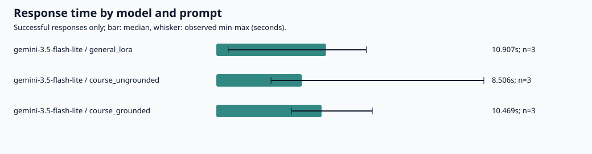

# Day1課題：会話履歴の実装と、応答時間・トークン数・回答内容の検証

## 1．取り組んだ課題と結果

**取り組んだ最高レベル：発展。会話履歴を保持する実装課題にも取り組んだ。**

2モデルを対象に、応答時間とトークン数を記録するコードを作成し、一般知識と講座固有の質問で試行した。講座固有の質問には、用語集の参考情報を直接付加する条件も設けた。

Gemini 3.5 Flash Liteでは3条件を各3回、計9回の回答を取得した。講座固有の質問は、参考情報なしでは3回とも名称・必要数が資料と一致せず、参考情報ありでは3回とも一致した。Gemini 3.8 Flashは初回と約11分後の再実行を合わせて4回ともHTTP 503となり、成功応答の時間・トークン数をモデル間で比較するデータは得られなかった。この経過も測定結果として保存した。

## 2．実装した内容

[app/ask.py](../../app/ask.py) に、会話履歴を保持する `Conversation` と `--chat` モードを追加した。

- ユーザーの発言とモデルの応答を順番に保存し、次の質問と一緒にAPIへ送る。
- `/reset` で履歴を初期化し、`/exit` で終了する。
- 失敗、ブロック、空応答のときは、そのやり取りを履歴に確定しない。
- 入力・出力・思考・合計トークンを区別して表示する。APIが値を返さない項目は「未提供」とする。

[計測コード](../../app/day1_benchmark.py) では、送信前の待機をAPI応答時間から分離し、成功・エラー・未送信を区別した。429や設定・認証関連のエラーでは該当モデルを停止し、503が2回連続した場合にも、それ以降の同モデルへの送信を止める。SDKによる自動再試行を無効にして、アプリ側の記録に現れない再要求を避けた。

[集計コード](../../app/day1_report.py) は、JSONLの記録から条件別の中央値・範囲、回答一覧、図を作成する。今回の2回分を整理するため、保存済みデータだけを読む [analyze_results.py](analyze_results.py) も追加した。今回の2実行を入力して再集計し、元の集計値と一致することを確認した。

### 動作確認

Codespacesで、会話履歴・計測・集計を対象とした次のテストを実行した。

```bash
uv run pytest -q tests/test_day1_chat.py tests/test_day1_benchmark.py tests/test_day1_report.py
```

ターミナルの実行表示は **34 passed in 1.74s** だった。これは会話履歴・計測・集計の各機能を対象としたオフラインテストである。実APIを使った検証は、以下の質問応答の計測として記録した。

## 3．実験条件

### 質問

| 条件 | 質問・追加情報 | 確認すること |
|---|---|---|
| 一般知識：LoRA | 元の重みと学習するパラメータを区別し、200字以内でLoRAを説明する | 同じ質問を繰り返したときの核心と表現の違い |
| 講座固有：参考情報なし | AIE2026の宿題の3レベルの名称と、必要な取り組み数を200字以内で説明する | 講座固有の事実への答え方と、根拠のない具体的内容 |
| 講座固有：参考情報あり | 同じ質問に、用語集の `homework-levels` の定義を付加する | 参考情報による回答内容とトークン数の変化 |

正しい名称は「基礎・実装・発展」、その回の宿題の完了に必要な取り組みは「いずれか1つ以上」である。配布の課題説明と [data/glossary.json](../../data/glossary.json) に照合した。質問中の「修了」は講座全体にも読めるため、ここでの評価対象を「その回の宿題の完了条件」に限定した。

| 項目 | 設定 |
|---|---|
| 要求モデル | `gemini-3.5-flash-lite`、`gemini-3.8-flash` |
| 反復数 | 初回は各モデル・各条件3回を計画。追測はFlashの共通2質問を各3回計画 |
| 出力上限 | 2048トークン。質問では200字以内を指定 |
| temperature・思考設定 | 各モデルの既定値 |
| 最小送信開始間隔 | 15秒 |
| SDKの最大試行回数 | 1。自動再試行なし |
| タイムアウト | 120秒 |
| 応答時間 | API呼出し開始から返却まで。通信・処理・生成を含む |
| 実行順 | 初回は質問順を並べ替え、モデル順を回ごとに入れ替える設定 |
| 環境 | Python 3.12.15、google-genai 2.31.0、GitHub Codespaces |

応答時間には送信前の待機や集計処理を含めない。モデル既定値を使用しているため、内部の生成条件や思考量まで同じ条件に固定した実験ではない。

## 4．実行件数と503の記録

実験日は **2026年10月23日、日本時間**。2回の実行を別のrun IDとフォルダに保存した。

| 実行 | 時刻 | 計画 | 実送信 | 成功 | HTTP 503 | 未送信 |
|---|---|---:|---:|---:|---:|---:|
| 初回 `day1_run` | 23:23:34〜23:26:18 | 18 | 11 | 9 | 2 | 7 |
| Flash追測 `day1_flash_retry` | 23:37:20〜23:37:39 | 6 | 2 | 0 | 2 | 4 |
| 合計 | — | **24** | **13** | **9** | **4** | **11** |

成功9回はすべてFlash Lite、503の4回と未送信11回はすべてFlashである。HTTP 429は0回だった。未送信は、各実行でFlashが連続2回503を返したため、停止処理が働いた件数である。

初回終了から **11分2.269秒** 空けてFlashだけを再実行したが、再び2回とも503となった。

| 実行 | 質問 | エラーが返るまでの時間 |
|---|---|---:|
| 初回 | LoRA | 3.913秒 |
| 初回 | 講座・参考情報なし | 2.463秒 |
| 追測 | LoRA | 2.179秒 |
| 追測 | 講座・参考情報なし | 3.754秒 |

これらはエラー応答までの時間であり、回答生成の速度として成功応答と比較していない。4件とも回答本文と使用トークン数を取得できなかったため、欠損値をそのまま保存した。

## 5．Flash Liteで得られた時間・トークン数

各条件3回の成功応答。トークン数はAPIの返却値で、時間とトークン数の中央値を示す。

| 条件 | 応答時間の中央値［最小〜最大］秒 | 入力トークン | 出力トークン | 合計トークン |
|---|---|---:|---:|---:|
| LoRA | 10.907［1.178〜14.914］ | 28 | 89 | 117 |
| 講座・参考情報なし | 8.506［5.436〜26.609］ | 35 | 106 | 141 |
| 講座・参考情報あり | 10.469［7.491〜15.517］ | 105 | 84 | 189 |

| 条件 | 1回目の時間／出力トークン | 2回目の時間／出力トークン | 3回目の時間／出力トークン |
|---|---|---|---|
| LoRA | 10.907秒／89 | 14.914秒／88 | 1.178秒／101 |
| 講座・参考情報なし | 8.506秒／106 | 5.436秒／93 | 26.609秒／110 |
| 講座・参考情報あり | 10.469秒／73 | 15.517秒／98 | 7.491秒／84 |

9件すべて終了理由は `STOP` で、出力上限による打切り・空応答・ブロックはなかった。成功分の合計は入力504、出力842、総数1,346トークンだった。思考・キャッシュのトークン数は全件未取得であり、0と補完していない。



## 6．回答内容の比較と考察

### 6.1 一般知識では核心が保たれた

LoRAの3回答は、いずれも「元の重みを固定する」「追加した低ランクのパラメータを学習する」という核心を満たした。行列ペアを説明する表現や強調箇所は変わった。

3回目には「元の性能を保ったまま」という補足があった。これは性能維持の保証として読むと強すぎるため、核心が合っていることと、補足まで無条件に正確であることを分けて評価した。

### 6.2 参考情報なしでは、もっともらしい誤答が繰り返された

| 試行 | 生成されたレベル名 | 生成された必要数・条件 | 判定 |
|---|---|---|---|
| 1 | 基礎・応用・実践 | 全3レベルを通じた合計「〇〇個」 | 名称が不一致、必要数も特定できていない |
| 2 | 入門・初級・中級 | 3つ・2つ・1つ、合計6つ | 名称と必要数が不一致 |
| 3 | ブロンズ・シルバー・ゴールド | 10個・20個・30個以上 | 名称と必要数が不一致 |

名称と必要数の両方を満たす回答は **0/3件** だった。答えを繰り返し生成しても正しい情報には収束せず、確かな出典を示さないまま、異なる具体的内容を提示した。「〇〇個」と残す回答もあり、文章が整っていることだけでは、実際の手続や条件の確認に使えない。

### 6.3 用語集を付加すると3回とも条件が一致した

用語集の該当定義を同じ質問に直接付加すると、3回答とも「基礎・実装・発展」と「どれか1つ」を答え、名称と必要数の一致は **3/3件** になった。説明を一段落にするか箇条書きにするかは変わったが、重要な条件は保たれた。

この3回の比較では、対象の根拠を入力に含める効果が確認できた。参照文に答えが含まれる小規模な実験であり、他の講座情報や複雑な質問でも同じ精度が得られるという結果ではない。

### 6.4 正確さと入力量・応答時間を併せて見る

参考情報の付加で、入力トークンは **35から105へ、70増加**した。出力トークンの中央値は106から84へ減ったが、APIが返した合計トークンの中央値は141から189へ増えた。今回は入力を追加することで、課題の条件に沿った回答を得ることができた。

応答時間の中央値は8.506秒から10.469秒に変わったが、両条件の範囲は重なっている。各3回のため、参考情報の追加だけが時間差の原因であるとは判断しない。参考情報なしの誤答には26.609秒かかった回答もあり、長い時間をかけたことや文章量を正確さの代わりにはできない。

### 6.5 文字数の自己申告もコードで確認した

9回答すべてが末尾に「193文字」などの文字数を記していた。改行・Markdown記号・自己申告部分を含めてPythonの `len(text)` で数えたところ、9件とも自己申告値と一致しなかった。例えば呼出し1は自己申告193文字に対し、保存文字列は164文字だった。

保存文字列の実際の長さは121〜199文字で、**200字以内という制約自体は9件とも満たしていた**。数え方を明示した [文字数の一覧](results/analysis/character_counts.csv) を残し、モデル自身の数値説明とプログラムによる検算を分けた。

意味内容の照合にはChatGPTを使用し、[AIによる評価一覧](results/analysis/ai_assisted_quality_review.csv) に評価者、基準、各回答の理由を明記した。503の4件は回答がないため、意味内容の得点や正答率の分母に含めていない。

## 7．無料枠のレート制限との関係

Google公式資料では、主な制限として毎分リクエスト数（RPM）、毎分入力トークン数（TPM）、毎日リクエスト数（RPD）が示され、プロジェクト単位で適用される。実際の上限はモデルや利用枠に応じてAI Studioで確認する仕組みである。[公式説明](https://ai.google.dev/gemini-api/docs/rate-limits)

今回の設定は送信開始間隔を15秒以上とし、連続送信時の平均は最大約4リクエスト/分となる。実行記録でも15秒以上の間隔を確認した。待機によって毎分の送信を抑えても、1日の総回数は減らない。また、参考情報を付加すると入力トークンが増えるため、リクエスト数だけでなく入力量も管理する必要がある。

当該プロジェクトの実際のRPM・TPM・RPD上限や残り枠は今回の記録に含まれていない。固定の送信間隔は実装上の設定であり、利用枠の余裕を測定した値ではない。

HTTP 503はサービスの利用可能性に関する応答、429は利用上限などに関する応答として区別した。[エラーの公式説明](https://ai.google.dev/gemini-api/docs/api-errors) 今回は503が4件、429は0件であり、503の詳細な原因や、無料枠の上限に達したかどうかは特定していない。

503を受けた初回終了から約11分空けて一度追加測定し、再び連続503になった段階で終了した。利用上限への配慮に加え、サービスから応答を得られない場合の停止・記録・再実行の扱いも、実験設計に含める必要があると分かった。

## 8．この実験で分かった範囲

今回、Flash Liteについては3条件の時間・トークン数・回答内容を比較できた。講座固有の情報では、用語集を与えることで、今回の評価対象となる名称と必要数が安定した。

Flashの成功データは得られず、両モデルの回答速度やトークン効率の優劣は判断できなかった。エラーが返るまでの短い時間を「速い回答」と扱わず、取得不能として残した。初回と追測は別時刻の実験として区別している。

各条件3回の小規模な観測で、通信・混雑・回答長・生成の揺れも影響する。中央値だけで評価を決めず、全観測値と本文を残し、欠損・失敗・未送信も含めて説明できることを重視した。

## 9．記録・再現方法

| 資料 | 初回 | Flash追測 |
|---|---|---|
| 実行条件 | [manifest](results/day1_run/manifest.json) | [manifest](results/day1_flash_retry/manifest.json) |
| 呼出し記録 | [JSONL](results/day1_run/results.jsonl) | [JSONL](results/day1_flash_retry/results.jsonl) |
| 全回答 | [responses](results/day1_run/responses.md) | [responses](results/day1_flash_retry/responses.md) |
| 条件別集計 | [summary](results/day1_run/summary.csv) | [summary](results/day1_flash_retry/summary.csv) |

2実行の [件数・時刻](results/analysis/run_summary.csv)、[条件別の再集計](results/analysis/condition_summary.csv)、[集計値と元ファイルのハッシュ](results/analysis/analysis_summary.json) も保存した。元ログは変更せず、run IDごとに保持した。

保存データだけを使う再集計は、リポジトリのルートで次を実行する。

```bash
python lectures/01/analyze_results.py
```

実APIを使った初回・追測のコマンドは以下だった。保存済みフォルダへの再実行は行わず、新たに実験する場合は別名のフォルダを指定する。

```bash
uv run python -m app.day1_benchmark --include-grounded --output lectures/01/results/day1_run --answer lectures/01/answer_generated.md --run
uv run python -m app.day1_benchmark --models gemini-3.8-flash --output lectures/01/results/day1_flash_retry --answer lectures/01/answer_flash_retry.md --run
```

講座参照コミットは `662cddd52724b330f3f4cd15123d1e55cb474874`。対象コード・用語集・依存関係ファイルのSHA256は各manifestに記録している。

### AI支援の利用

コード作成、検証観点の整理、保存ログの集計・参照資料との照合、考察の文章化にChatGPTを利用した。APIの実行と34項目のテストは自分のCodespacesで行い、実測結果とその結果から判断できる範囲を記述した。意味内容の評価一覧にはAIによる照合であることを明記している。

### 参考資料

- 第1回演習講義資料 p.14〜16、および宿題資料。
- [講座のDay1課題](https://github.com/matsuolab/lecture-ai-engineering-2026/blob/662cddd52724b330f3f4cd15123d1e55cb474874/lectures/01/problem.md)
- [講座の用語集](https://github.com/matsuolab/lecture-ai-engineering-2026/blob/662cddd52724b330f3f4cd15123d1e55cb474874/data/glossary.json)
- [Gemini API：Rate limits](https://ai.google.dev/gemini-api/docs/rate-limits)
- [Gemini API：API errors](https://ai.google.dev/gemini-api/docs/api-errors)
- [Gemini API：Troubleshooting](https://ai.google.dev/gemini-api/docs/troubleshooting)
