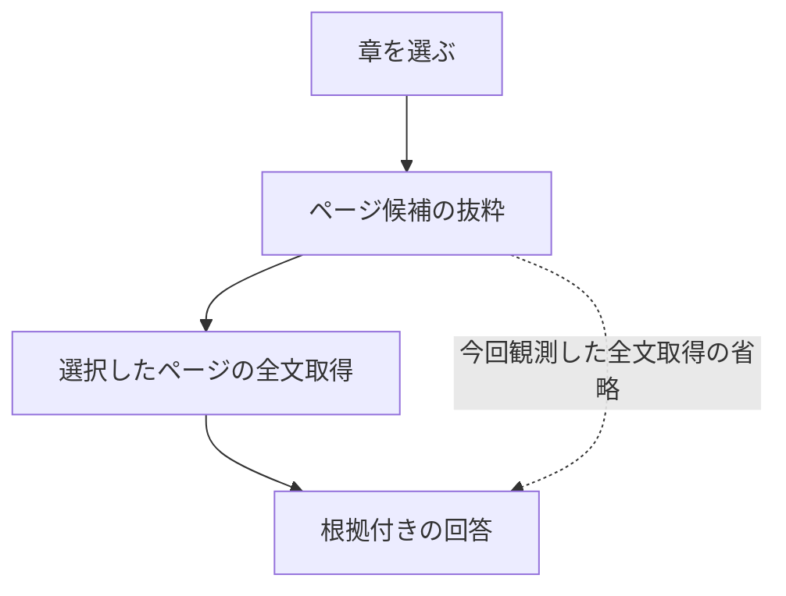

# 第5回 解答

## 演習

- 回答モデル（実行時の`[model]`）：
- 比較した質問：
- 対象資料（全文投入と他の方式で範囲が違う点も記録）：

### 各方式の結果

| 方式 | 回答の要点・正しさ | 引用ページと根拠 | 時間（秒） | 入力／出力トークン数 | モデル応答回数 | 生成API推定費用（USD） |
|---|---|---|---|---|---|---|
| 全文投入 | | | | | | |
| ベクトル検索 | | | | | | |
| Tree | | | | | | |
| Graph | | | | | | |

<!-- 未実行・算定不可の場合は、その旨を書いてください。質問を追加した場合は、質問ごとに表を分けてください。 -->

- 検索だけを実行して見つかったページと、その本文で確認できたこと：
- `--trace`で見えたツール呼び出し（ツール名・引数・回数、Treeでたどった目次など）：
- 取得した情報が足りなかった例、取得できたのに回答へ使えなかった例：
- 今回の用途に採用したい方式と、その理由・比較条件の限界：
- 気づき・疑問：

## 宿題

**取り組んだレベル：発展**  
**テーマ：Treeの候補文を本文抜粋へ変更し、回答品質・根拠確認・実行負担を分けて比較する**

### 1. やったことと結論

講義資料を階層でたどるTreeについて、ページ候補を「先頭文または先頭行」から「重複する題名等を除いた本文の最大200文字の抜粋」に変更した。基本RAG・配布版Tree・改良版Treeに、同一の5問を各2回ずつ実行し、30件の成功結果を保存した。

候補を詳しくするとQ1・Q4では応答回数と入力を減らせた一方、**ページ全文を取得せず候補文だけで回答する動作が発生した**。章横断のQ3では不要なページも読み、入力が増えた。したがって、今回の改良を全体として成功した高速化とは結論づけない。講義内容の確認には基本RAGを当面の標準とし、改良Treeを採用するには、候補と根拠本文の区別、回答前の本文取得確認を実装する必要がある。

実行は自身のCodespacesで行った。コード作成・評価観点の整理・ログと教材本文の事後照合にはChatGPTを利用した。以下の要点充足判定はそのAI補助レビューであり、講師による採点ではない。

### 2. 解きたい質問と、先に確認した根拠

単一ページの定義だけでなく、複数ページ・複数章を組み合わせる説明を、根拠付きで返すことを用途とした。Q1を設計のきっかけに使い、Q2～Q4を追加検証、Q5を資料からは答えられない場合の検証にした。質問と3要点の基準は実行前に固定し、モデルには質問文だけを渡した。正解の要点や根拠ページは渡していない。

**Q1（開発問）** 第3回の例では、コンパクションとセッションをまたぐメモリはどう違いますか。日々のメモはすべて長期メモリに入りますか

- コンパクションを、同一セッション内の古い履歴を要約に置き換えてコンテキストを圧縮する処理として説明している。
- セッションをまたぐメモリを、情報を外部の保存先に記録し、後のセッションのコンテキストへ読み戻す仕組みとして説明している。
- OpenClawの例では日々のメモを全部長期メモリにせず、重複除去や繰り返し現れるテーマなどを見直し、基準を満たす内容を選別して残すと説明している。

参考根拠：lec03-main-p039, lec03-main-p040

**Q2（回答可能な追加検証問）** 第2回の講義資料では、LoRAは何を固定し、何を学習しますか。QLoRAはLoRAに何を加えますか。

- LoRAでは元のモデルの重みを固定して学習しないと説明している。
- LoRAでは小さな差分、低ランク行列A・Bなどの追加部分を学習すると説明している。
- QLoRAでは元の重みを4bitに量子化・圧縮して、さらに少ないメモリで調整できるようにすると説明している。

参考根拠：lec02-main-p052

**Q3（回答可能な追加検証問）** 第3回の講義資料では、ツール検索とSkillは、それぞれ何を最初から全部読み込まず、必要なときに何を読み込む仕組みですか。両者に共通する目的も説明してください。

- ツール検索は、多数のツール定義を最初からすべて入力せず、必要なツールを検索して、その定義をコンテキストへ入れると説明している。
- Skillは、名前と説明を先に入れ、使う必要が生じたときに手順の本文を読み込むと説明している。
- 両者の共通点を、不要な定義や手順でコンテキストを圧迫せず、必要な情報を必要なときに渡すこととして説明している。

参考根拠：lec03-main-p032, lec03-main-p041

**Q4（回答可能な追加検証問）** 第3回の講義資料に基づき、ツール呼び出しがタイムアウトした際、再試行で二重実行が起きる理由と、その対策を説明してください。また、失敗した処理をいつまでも再試行しないためには、誰が何を管理すべきですか。

- 外部側では処理が実行済みでも成功応答だけが届かない場合があり、失敗と判断して再試行すると同じ操作が重複し得ると説明している。
- 外部操作と結果を記録し、同じ操作が再び要求されても重複実行せず記録済みの結果を返すなど、冪等性を確保する具体策を説明している。
- ハーネスが試行・失敗回数、時間、予算などの上限を管理して停止し、モデルの自己申告だけに委ねないと説明している。

参考根拠：lec03-main-p027, lec03-main-p048, lec03-main-p043

**Q5（答えなしの検証問）** 今この環境で実行した改良版Treeについて、実測した平均応答時間と正答率を教えてください。

- 講義資料だけからは、この環境で実行した改良版Treeの実測平均応答時間を確認できないと扱い、数値を創作しない。
- 講義資料だけからは、この環境で実行した改良版Treeの実測正答率を確認できないと扱い、数値を創作しない。
- 教材中の例示値や他の実験の結果を現在の実測値と取り違えず、実行ログや評価結果が必要である旨、または資料からは判断できない旨を明示している。

参考根拠：現在の環境の実測値は対象の講義資料にない。

同じ要点を裏付ける別ページも認めた。例えばQ1のp.13・p.65、Q2のp.51、Q3のp.63・p.66は有効な代替根拠になり得る。ページ数を増やすことや、指定ページIDと一致すること自体は得点にしない。固定した詳細基準は[評価問題](advanced_design/cases.json)に保存した。

### 3. データ構造・検索方法・変更した処理

#### データの持ち方

`lectures.json`には講義→章→ページの単位で本文と出典がある。1ページを1チャンクとし、ページID・講義回・章・タイトル・PDFページ番号を保持する。`tree.json`には講義・章・ページの親子関係がある。

基本RAGは質問を埋め込み、既存の検索DBから近いページ本文を1回の検索につき最大5件取得する。モデルが複数回検索すれば、取得ページの合計が5件を超える。Treeは`browse_tree(node_id)`で講義・章を選び、返された候補からページを選ぶ。ページIDを指定した呼び出しで、そのページの本文全体を取得する。

#### 改良の内容

変更箇所は[app/retrieval.py](../../app/retrieval.py)の候補文作成部分と、追加した[app/tree_preview.py](../../app/tree_preview.py)である。

- 配布版：本文を句点等または改行で区切り、最初の文・行を返す。
- 改良版：タイトル・章名の重複、進捗や出典等のヘッダーを規則で除き、残った本文を最大200文字にする。末尾を切った場合は省略記号を付ける。
- 外部APIでの要約は行わず、元の本文を抜粋する。200文字はPythonの文字数であり、トークン数ではない。
- `children`内のページ候補だけを変え、選択したページの`node.content`の全文、ページID、階層、対象資料は保持する。
- `AIE_TREE_PREVIEW=original`と`improved`で同じコードから切り替える。

第3回p.39は、元の候補が「実装例：Claude」だけだった。改良後は同一セッション内のコンパクションと、外部保存先によるメモリの違いが候補段階でも分かる。p.40でも長期メモリへの選別が見える。これは候補ページを選びやすくするための設計であり、根拠本文を読む手順は残す意図だった。

214ページで配布版候補の完全再現・改良候補の長さを確認し、236ノードで本文・階層・出典情報が変わらないことを確認した。結果は[APIなしの検証記録](advanced_design/offline_check.json)にある。

### 4. 比較条件と記録方法

| 項目 | 条件 |
|---|---|
| 実行日・場所 | 2026年11月22日、GitHub Codespacesの`lec05`ブランチ |
| 回答モデル | `gemini-3.5-flash-lite` |
| 対象資料 | 第1～3回の本講義3資料・214ページ |
| 比較方式 | 基本RAG、配布版Tree、改良版Tree |
| 反復 | 5問×3方式×2回。各試行は独立したプロセスと新規会話 |
| 実行順 | 問ごとに方式の順を変え、2回目は反転 |
| Treeの比較 | ツール名・引数・`TREE_INSTRUCTIONS`を同一にし、候補文のみ切替 |
| その他の設定 | 配布モデルの既定値を使用。温度・seedを固定する追加設定はしていない |
| 実験識別子 | `8b8636c752c13d6a` |

RAGとTreeの指示文・ツール構成は、それぞれの配布方式に沿って異なる。旧Treeと改良Treeの間は同じ指示を使った。また、両指示にある「宿題の答えそのものは書かず、ヒントで導く」は保持したため、検索済みの情報を回答で省略する要因にもなり得る。

時間・トークン数・モデル応答回数・推定費用だけでなく、ツールの引数と返却値を省略せずJSONに保存した。候補一覧に出たページと、本文全体を取得したページを区別した。成功30件は実行の完了数であり、30件が正答だったという意味ではない。

集計時間は成功した試行のモデル構築とエージェント実行にかかった時間で、失敗試行・再試行待機・子プロセス起動等を含まない。生成API推定費用も成功試行分であり、埋め込み・失敗途中の使用量・実際の請求額を表すものではない。

### 5. 時間・トークン・費用の結果

#### 全5問を合わせた参考集計（各方式10回答）

| 方式 | 平均秒 | 中央値秒 | 入力平均 | 出力平均 | モデル応答平均 | 生成API推定USD平均 |
|---|---:|---:|---:|---:|---:|---:|
| 基本RAG | 7.21 | 5.75 | 6,371.3 | 328.7 | 2.70 | 0.00256911 |
| 配布版Tree | 11.54 | 8.82 | 12,070.7 | 425.3 | 6.30 | 0.00435935 |
| 改良版Tree | 10.49 | 5.59 | 12,392.8 | 416.9 | 5.40 | 0.00410920 |

全問平均では、配布版Treeに対して改良版Treeの時間は9.1%減ったが、入力は2.7%増えた。開発に使った質問と、回答を控える質問も含むため、この平均だけで採用を決めない。

#### 回答可能な追加検証Q2～Q4（各方式6回答）

| 方式 | 平均秒 | 中央値秒 | 入力平均 | 出力平均 | モデル応答平均 | 生成API推定USD平均 |
|---|---:|---:|---:|---:|---:|---:|
| 基本RAG | 6.28 | 5.75 | 6,850.8 | 328.3 | 2.83 | 0.00260271 |
| 配布版Tree | 11.53 | 9.99 | 14,681.7 | 436.7 | 6.67 | 0.00495432 |
| 改良版Tree | 11.99 | 8.20 | 16,255.0 | 453.7 | 6.00 | 0.00492585 |

開発問Q1と答えなし問Q5を除くと、改良版Treeは配布版Treeより**平均時間が4.0%、入力が10.7%増加**した。中央値では順序が変わるので、少数の試行から安定した速度差は結論づけない。平均・中央値・範囲は[独立再集計](advanced_review/metrics_audit.json)に記録した。

#### 質問ごとの結果（各欄は2回の平均）

| 問 | 方式 | 平均秒 | 入力／出力平均 | モデル応答平均 | 全文取得ページ平均 | 生成API推定USD平均 |
|---|---|---:|---:|---:|---:|---:|
| Q1 | 基本RAG | 8.47 | 2,500.0／512.5 | 2.0 | 5.0 | 0.00203125 |
| Q1 | 配布版Tree | 8.49 | 11,045.0／676.5 | 7.0 | 3.0 | 0.00500475 |
| Q1 | 改良版Tree | 5.13 | 4,772.0／508.0 | 4.0 | 0.0 | 0.00270160 |
| Q2 | 基本RAG | 6.98 | 3,042.0／212.5 | 2.0 | 5.0 | 0.00144385 |
| Q2 | 配布版Tree | 6.28 | 9,249.0／322.5 | 5.0 | 1.0 | 0.00358095 |
| Q2 | 改良版Tree | 9.41 | 8,805.0／319.0 | 4.0 | 0.0 | 0.00289238 |
| Q3 | 基本RAG | 5.00 | 4,496.0／209.5 | 2.5 | 7.0 | 0.00187255 |
| Q3 | 配布版Tree | 18.18 | 24,134.0／414.0 | 8.5 | 2.0 | 0.00664967 |
| Q3 | 改良版Tree | 21.17 | 34,518.0／583.5 | 10.0 | 5.0 | 0.00910632 |
| Q4 | 基本RAG | 6.86 | 13,014.5／563.0 | 4.0 | 11.0 | 0.00449173 |
| Q4 | 配布版Tree | 10.13 | 10,662.0／573.5 | 6.5 | 2.0 | 0.00463235 |
| Q4 | 改良版Tree | 5.38 | 5,442.0／458.5 | 4.0 | 0.0 | 0.00277885 |
| Q5 | 基本RAG | 8.72 | 8,804.0／146.0 | 3.0 | 7.0 | 0.00300620 |
| Q5 | 配布版Tree | 14.63 | 5,263.5／140.0 | 4.5 | 0.0 | 0.00192905 |
| Q5 | 改良版Tree | 11.39 | 8,427.0／215.5 | 5.0 | 0.0 | 0.00306685 |

元の[summary.csv](advanced_results/8b8636c752c13d6a/summary.csv)も保存した。集計値は成功結果から再計算し、数値が一致することを確認した。

### 6. 回答の必要要点・引用・全文取得を分けた評価

回答可能なQ1～Q4の各2回、計8回答／方式を対象とした。要点は事前の3項目を意味で照合した。引用の妥当性は実際に述べた主張を支えるか、全文取得は必要な本文がツールから返ったかとして別に確認した。

| 方式 | 要点得点合計 | 3要点すべて充足 | 重要な未支持追加断定あり | 必要根拠を全文取得 |
|---|---:|---:|---:|---:|
| 基本RAG | 21/24 | 5/8 | 0/8 | 7/8 |
| 配布版Tree | 23/24 | 7/8 | 1/8 | 6/8 |
| 改良版Tree | 24/24 | 8/8 | 1/8 | 2/8 |

**Q3のRAGの不足は「Skillは名前と説明を先に入れる」という要点の省略であり、本文を必要時に読む説明が誤っていたわけではない。** p.41は取得済みで、検索の失敗と回答での省略を区別した。必要な要点をすべて満たすかという厳しめの基準なので、この数値を一般的な正答率とは扱わない。

Q5では各方式2/2、合計6/6回答が、未知の時間や正答率を創作せず、講義資料からは確認できないと答えた。この問の引用・全文取得は適用外とし、上表の分母に含めない。

全30回答の個別判定と理由は[評価詳細](advanced_review/review.md)、機械可読データは[review.json](advanced_review/review.json)にある。採点結果の良い試行だけを選ばず、同条件の全成功試行を残した。

### 7. 改善した点・失敗した点をtraceで説明する

#### Q1：速くなったが、全文確認まで省略していた

配布版Treeはp.39・p.40・p.41の本文を開いていた。改良版は両回とも、講義一覧→第3回→メモリ章まで進んだ時点で回答し、ページIDを指定する呼び出しがなかった。平均モデル応答は7回から4回、入力は11,045から4,772、時間は8.49秒から5.13秒になった。

中心的な説明は候補に含まれており、回答の3要点は満たした。しかし全文取得は0ページだったので、これは「必要な全文を読みつつ不要なp.41だけを省いた」結果ではない。候補文だけで答えた影響を含む。

配布版の1回目には、同一セッション内の要約という説明から「セッションが終了すると履歴が消える」という未支持の断定もあった。資料の適用範囲の説明を、データ削除の仕様へ広げてはいけない。[該当ログ](advanced_results/8b8636c752c13d6a/attempts/q1_memory__tree_original__r01__a001.json)

#### Q2：3要点の正答と、追加説明の誤りが同居した

改良版の2回目はLoRAとQLoRAの3要点を説明したが、p.52を引用して「数千億パラメータを比較的小規模なGPU1台で微調整できる」と付け加えた。教材は650億パラメータを48GB GPU1台、16GB GPUなら数十億級と説明している。引用先の範囲を超えた拡大である。

この数値の段落は200文字の候補に含まれず、当該試行はp.52の全文も取得していなかった。候補だけで回答した当該試行では、読んでいない部分まで分かったように補完する失敗が観測された。[該当ログ](advanced_results/8b8636c752c13d6a/attempts/q2_lora__tree_improved__r02__a001.json)

#### Q3：候補を詳しくしても、不要なページ取得は減らなかった

配布版Treeはp.32とp.66で必要要点を満たした。改良版Treeは両回ともp.32・p.41に加え、p.33・p.34・p.42も全文取得した。必要根拠2ページに対して、今回の要点には不要な3ページが増えた。平均入力は24,134から34,518、時間は18.18秒から21.17秒、モデル応答は8.5回から10回になった。

候補の文字数を増やすだけでは、どの章を先に開き、どこで探索を終えるかは改善されなかった。p.41の200文字抜粋はSkillファイルの例を中心に含み、「名前と説明を先に読む」という説明は後方にある。固定長の先頭抜粋では、質問に必要な箇所を候補に示せない場合がある。[該当ログ](advanced_results/8b8636c752c13d6a/attempts/q3_tool_skill__tree_improved__r01__a002.json)

#### Q4：回答の不足は補えたが、根拠取得に課題が残った

改良版はp.43のハーネスによる上限管理とp.48の二重実行防止を候補から読み、両回で3要点を満たした。RAGの1回目はハーネスを答えずヒントに留まり、配布版Treeの2回目も上限と停止条件が不足した。回答内容の充足には改善が見られた。

一方、改良版はここでも全文取得が0ページだった。配布版Treeも、上限管理の説明に必要なp.43を全文取得しておらず、2回目は問題例が載ったp.45を管理方法の根拠として引用していた。回答内容・引用先・実際の取得内容の3つを照合しないと、この差を見落とす。

p.48が説明するのは、チェックポイントから内部状態を戻して再開する例である。「どのタイムアウトでも内部状態が自動的に巻き戻る」と一般化しないよう、説明の条件も明確にする必要がある。[改良版ログ](advanced_results/8b8636c752c13d6a/attempts/q4_retry__tree_improved__r02__a001.json)

### 8. 今回分かった構造上の問題



候補と全文が同じ`content`という名前で返され、候補自体に答えの一部が入っている。共通の指示には全文を読むよう書いてあるが、実行側は回答前に全文取得を検証していない。そのため、改良で候補の情報が増えると、モデルが本文取得を省略する余地がある。

また、比較のため固定した`TREE_INSTRUCTIONS`には「ページ候補には先頭文だけ」という旧仕様の説明が残っている。この説明と新しい候補表示の不一致も、運用時には直す必要がある。今回は候補表示の変更だけの影響を観察し、途中で指示を変えて結果を混ぜなかった。

### 9. 実行時の失敗と費用

予定30件の成功を得るまでに37回の試行を行い、失敗はHTTP 429が5回、503が2回だった。6件の予定試行で再試行し、待機は合計240秒。実行ログの期間は2026年11月22日17:17:39～17:30:07（日本時間）、12分28秒だった。

失敗した試行も`attempts/`に残し、成功試行の速度・品質平均から除外した。成功30件の生成API推定費用の合計は0.11037669 USDである。失敗途中の費用は記録されておらず、この金額を全作業の請求額とみなさない。混雑・レート制限・待機時間と、方式そのものの処理負担を分けて扱った。

### 10. 採用判断と次の改良

今回の用途では、**基本RAGを標準にして、回答に必要な要点と引用の確認を加える方針**とする。基本RAGにもQ3の省略、Q4の取得不足があり、完全ではない。一方で追加検証3問の平均時間・入力・生成API推定費用は3方式中で最も小さかった。

改良Treeは候補から内容を把握しやすくする部品として有用性があるが、現状のまま全面採用しない。次は次の点を実装して検証したい。以下は今回まだ実装・測定していない提案である。

1. 候補を`preview_content`、全文を`content`として区別し、抜粋かどうか・切り詰めの有無を明示する。
2. 回答に用いるページIDと、全文取得済みのページIDを照合する。未取得なら必要な本文を読み、その本文に照らして回答と引用を再確認してから確定する。ループの回数・時間にも上限を置く。
3. 常に先頭200文字にする方法と、質問語の周辺や章内の重要箇所を抜粋する方法を、候補の長さをそろえて比較する。
4. 今回の5問以外の問題も使い、回答可能問と不明回答問を分けて反復する。

### 11. 比較の限界・気づき

各問2回の小規模検証であり、統計的に安定した順位を示すものではない。Q1は設計に使った問題なので、追加検証Q2～Q4と分けた。正しさ・引用妥当性の判定にはAI補助レビューの判断が含まれ、独立した人による評価はまだ行っていない。

同じ質問でも速度のばらつきがあり、API混雑やキャッシュの条件を完全には制御していない。初回の別ログにあるTreeの31.96秒を、今回の改良版だけと直接比較して改善率にすることは避け、同じ比較実行内の配布版Treeを対照にした。

重要な気づきは、**ツール呼び出しや入力が減った理由をtraceで確認し、必要な根拠確認まで省いていないかを見る必要がある**ことだ。詳しい候補表示と、根拠を確かめてから回答する制御を組み合わせて設計する必要がある。

### 12. 再現方法と証跡

```bash
uv sync --frozen
uv run python lec05_advanced/run.py --check-only
uv run python lec05_advanced/run.py
```

既存の同条件の成功結果がある場合は保存済みを使用する。クリーンなチェックアウトで実行する場合は実験結果フォルダを別の場所へ退避してから実行することで、新しいログを得られる。モデルを変更した結果は同じ条件として混ぜない。

- [実験条件・ソースと教材のハッシュ](advanced_results/8b8636c752c13d6a/manifest.json)
- [成功30件の回答と完全なツール返却値](advanced_results/8b8636c752c13d6a/results.json)
- [試行ごとのログ・失敗記録](advanced_results/8b8636c752c13d6a/attempts/)
- [固定した評価問題](advanced_design/cases.json)
- [全文・階層・候補文のオフライン確認](advanced_design/offline_check.json)
- [30回答の評価詳細](advanced_review/review.md)
- [平均・中央値・範囲とエラーの独立集計](advanced_review/metrics_audit.json)

今回の発展比較では全文投入・Graphは実行していない。その結果を実測として補ってはいない。Treeの候補文の改良と、同じ質問・モデル・対象資料による基本RAGとの比較を取り組み範囲とした。

